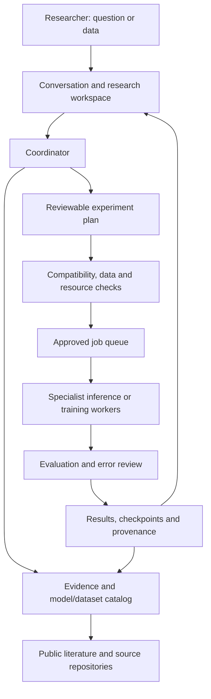

# Cancer research platform: product and technical design

## Product decision

Build a cancer research workspace where someone can **ask a question, find appropriate data and models, compare methods, develop a new model, and reproduce the resulting experiment**. Use one conversational coordinator over a searchable knowledge base, a model/dataset registry, and independently executable specialist tools.

The initial audience is researchers, students, and model developers. General cancer education can share the interface, with cited explanations. Patient-specific diagnosis, treatment selection, and clinical deployment require a separate validated product pathway. A model's research availability is not evidence that its output is suitable for a patient's care.

The long-term ambition is broad coverage of cancer research. The first release should earn trust through a few complete workflows and explicit coverage labels. A catalog entry must distinguish **discoverable**, **access obtained**, **runnable**, **locally reproduced**, and **externally evaluated**. A training run finishing successfully must not silently upgrade those labels.

This document is a design and acquisition plan. It does not create workloads, obtain gated access, download datasets or weights, or authorize compute consumption.

## Accepted researcher priorities and implementation direction

The primary user is a cancer researcher or model developer. Dataset investigation and training assistance are core responsibilities across all three reuse paths, alongside reasoning and reliable specialist use. The platform should find data, examine its source and reference labels, assess usefulness for the intended task, flag leakage and uncertainty, and help researchers build reproducible experiments. Automated audits can verify particular integrity properties; they cannot certify that every label is true.

The selected large-machine coordinator candidate is **[Google Gemma 4 31B IT](https://huggingface.co/google/gemma-4-31B-it)**. A smaller quantized Gemma 4 is the local-computer candidate; neither has been tested in this project. Specialists add their own parameter counts and compute needs. The coordinator can remain relatively compact while accessing specialist capabilities; the complete pipeline must still prove its performance on each supported task.

Keep the three useful paths: **reasoning and specialist-tool use**, **transfer learning from pretrained checkpoints/features**, and **teacher-guided distillation**. Blend dataset/evidence review and training engineering through all three rather than isolating them as an optional fourth product. Preserve reasoning/coding competence with base-versus-adapted regression evaluations and held-out general tasks. Keep source retrieval and the registry current without requiring a retraining run for every new paper or model.

The cancer-checking ambition is task-specific performance competitive with strong reproducible specialists. Evidence must include matched inputs, reference standards, independent grouped evaluation, sensitivity/false-positive tradeoffs, calibration, uncertainty, and full-pipeline routing failures. Do not infer best-in-class accuracy from the Gemma parameter count or from agreement with a teacher. Preserve the source expert as a callable option when a student has not met its measured target.

An executable local foundation now accompanies this design in `cancer-research-foundation/`. It implements compatibility checks, installed-adapter interfaces, manifest audits and optional local file hashing, reviewed tool-conversation export, three-path experiment planning, and supervised/distilled linear classifiers over precomputed features. Its tests use synthetic fixtures. It has no live Gemma service, internet connector, real cancer-model adapters, or NPS submission backend; no medical performance is claimed. The separate local OncoCopilot build adds draft integrations. Full encoder/LLM fine-tuning and real-data evaluation still require chosen artifacts and approved execution scope.

## The opportunity and existing work

The problem is partly fragmentation: researchers encounter models with different formats, preprocessing, licenses, outputs, and evaluation populations. The useful product is a compatibility and reproducibility layer that makes those differences visible and helps users complete experiments.

There is substantial existing infrastructure. [MONAI Model Zoo](https://project-monai.github.io/model-zoo.html) packages pretrained medical models, [Grand Challenge](https://grand-challenge.org/about-us/) supports data, algorithms, and evaluation, and [MedRAX](https://github.com/bowang-lab/MedRAX) demonstrates a tool-using medical agent for chest X-rays. NCI provides cancer data resources. These are foundations and comparators, not evidence that the market is empty.

The proposed differentiator is one workflow connecting **research evidence → eligible dataset → compatible model → reproducible execution → measured performance → reusable new model**. Whether users value this enough to make it their default workspace remains a product hypothesis to test with researchers.

## What users should be able to do

| User request | Required platform behavior | Concrete output |
|---|---|---|
| “What is known about this cancer or method?” | Search authoritative summaries and primary papers; separate established findings, conflicting evidence, and preliminary results | Cited explanation with source dates, population, endpoint, and uncertainty |
| “Find a model for my data.” | Inspect modality/anatomy/format; match input requirements, endpoint, license, resources, and evidence | Ranked eligible candidates with reasons and exclusions |
| “Which datasets could I use?” | Find source releases; inspect label meaning, access, pairing, overlap, and acquisition burden | Dataset shortlist and a specific acquisition recommendation |
| “Can these models work together?” | Check preprocessing, spatial geometry, output semantics, population, and licensing | Compatibility report or a proposed pipeline with unresolved requirements |
| “Compare these models.” | Use the same eligible cases, preprocessing contract, split, and metrics | Reproducible comparison, failure examples, resource measurements |
| “Train a model for this task.” | Define endpoint; audit data; generate a baseline and reviewable job configuration | Code/configuration, resource estimate after profiling, planned evaluation |
| “Improve this model.” | Inspect learning curves and errors; recommend targeted experiments | Ranked experiment queue with a reason for each experiment |
| “Why did my job fail?” | Read permitted logs, allocation, checkpoints, storage, and environment details | Diagnosis of the engineering failure and a proposed repair |
| “Help me label the difficult cases.” | Select useful unlabeled cases; present assisted annotations for review | Reviewed annotations with provenance and disagreement records |
| “Can this run on a Jetson or a smaller GPU?” | Profile, compress or distill if permitted, export, and re-evaluate | Device-specific latency/memory/accuracy comparison |
| “Share or reproduce this result.” | Package the exact model, data references, preprocessing, splits, configuration, and metrics | Reproduction instructions and a model card; files only when redistribution is permitted |

Support two entry points: a conversation for intent and explanation, and a structured workspace for datasets, images, experiments, and results. The structured state is authoritative; important choices must not live only in chat history.

## Main assistant and specialist components

The components below are responsibilities, not a requirement to run a separate language model for every responsibility. One coordinator can call multiple tools and shared services.

| Component | Responsibility | Initial implementation decision |
|---|---|---|
| Coordinator | Understand the request, plan steps, call tools, explain results, preserve experiment context | Start with Gemma 4 31B IT on large compute, a smaller Gemma locally; compare against Nemotron 3.5 Super on real project tasks. Keep the provider replaceable. |
| Evidence researcher | Search papers and cancer resources; extract study design, populations, endpoints, and limitations | Source retrieval plus coordinator; benchmark MedCPT retrieval/reranking for biomedical literature |
| Dataset curator | Inspect source releases, schemas, labels, duplicates, provenance, eligibility, and missing data | Deterministic validators plus assisted extraction; human review for label interpretation |
| Compatibility router | Decide which registered models can process the input and answer the requested task | Explicit rules and typed input/output contracts, assisted by metadata/image checks |
| Imaging specialists | Detection, segmentation, classification, representation extraction | Existing domain models, each behind its own adapter |
| Medical vision-language assistant | Explain medical image/text inputs and help create structured research summaries | MedGemma 1.5 4B as an evaluated auxiliary tool; do not use it to invent specialist findings |
| Training engineer | Generate and repair data loaders, training configurations, evaluation code, and experiment plans | Coordinator in a restricted development environment with reviewed job templates |
| Evaluator | Run held-out evaluation, calibration, subgroup and robustness analyses | Deterministic statistics and task-specific metrics; avoid using an LLM judge as the sole medical ground truth |
| Experiment manager | Submit approved jobs, track logs/checkpoints, resume/cancel, enforce budgets | Queue plus an NPS Run:ai adapter after the actual CLI/API contract is verified |
| Registry steward | Record versions, availability, licensing, evidence, and superseded releases | Database plus MLflow model/experiment lineage |

The general-model choices and rough memory considerations are detailed in the companion model research note. [MedCPT](https://github.com/ncbi/MedCPT) is an existing biomedical retrieval system; [MedGemma](https://developers.google.com/health-ai-developer-foundations/medgemma/model-card) is a medical text/image model; neither replaces a task-specific evaluation.

## Which existing models to connect

“Best” should mean best for a named task, population, input protocol, and resource budget, under comparable evaluation. The following are strong integration candidates or useful baselines, not a claim that every one is the current benchmark winner. No listed artifact was downloaded or tested here.

| Specialist task | Existing candidates | Decision and limitation |
|---|---|---|
| Bone radiograph representation/classification | [MedSigLIP](https://developers.google.com/health-ai-developer-foundations/medsiglip) plus a small classifier; a conventional pretrained image backbone for comparison | Build the first bone-task head over frozen features. No ready-made bone-cancer checkpoint was established as a trustworthy winner in this research. |
| Brain tumor MRI segmentation | [MONAI BraTS segmentation bundle](https://project-monai.github.io/model-zoo.html); task-trained nnU-Net | Useful existing specialist path. Require the exact MRI channels and preprocessing; segmentation labels are not histologic diagnosis. |
| Pulmonary nodule detection on CT | [MONAI lung-nodule CT detector](https://project-monai.github.io/model-zoo.html) | Reproducible integration candidate; detecting a nodule is a different endpoint from determining malignancy. |
| Prostate cancer detection on MRI | [PI-CAI challenge algorithms](https://pi-cai.grand-challenge.org/algorithms/) | Prioritize challenge-backed methods. Access to a hosted algorithm is not proof that its weights and training code can be downloaded. Verify per entry. |
| Histopathology representation | [H-optimus-1](https://huggingface.co/bioptimus/H-optimus-1), [UNI2-h](https://huggingface.co/MahmoodLab/UNI2-h), [Virchow2](https://huggingface.co/paige-ai/Virchow2) | High-capability research comparison group. They extract features and need a downstream task head; their access and redistribution restrictions affect platform use. |
| More permissive pathology starting point | [H-optimus-0](https://huggingface.co/bioptimus/H-optimus-0) | Card lists Apache 2.0, with gated access conditions. Consider before adopting a restricted model as a public platform dependency. Still needs downstream validation. |
| Skin lesion representation/classification | [PanDerm](https://github.com/SiyuanYan1/PanDerm) | Strong domain-specific candidate; its authors explicitly require task-specific linear probing or fine-tuning. Keep dermoscopy and ordinary clinical-photo protocols distinct. |
| Interactive annotation | [MedSAM2](https://github.com/bowang-lab/MedSAM2), [VISTA3D](https://github.com/Project-MONAI/VISTA/tree/main/vista3d) | Assist segmentation and expert correction. Prompted masks do not automatically become verified tumor labels. |
| Anatomical preprocessing | [TotalSegmentator](https://github.com/wasserth/TotalSegmentator) | Useful CT/MR anatomy tool. Select the specific subtask and its license; anatomy masks are not a universal cancer detector. |
| New segmentation problems | [nnU-Net](https://github.com/MIC-DKFZ/nnUNet) | A strong self-configuring training framework, rather than one pretrained model that handles every cancer. |
| Breast/other-organ expansion | Task-matched pathology or imaging models with a reproducible public artifact | Add a validated task explicitly. A breast-density model or prostate-zone segmenter must not be advertised as a cancer detector. |
| Molecular and multimodal prediction | Endpoint-specific tabular/survival baselines before larger representation models | Defer until appropriately paired outcomes, specimens, and imaging exist. No generic pan-cancer prediction model is selected by default. |

The pathology cards are especially important: H-optimus-1, UNI2-h, and Virchow2 list noncommercial/no-derivatives or additional access conditions. The platform must support discovery, institution-owned weights, permitted hosted access, and links to the original publisher. It must not equate “downloadable” with permission to rehost or redistribute an adapted model. Exact current artifact terms need review before integration; no legal agreement was accepted here.

## Architecture and compatibility

The catalog can describe every cancer domain while execution remains limited to supported adapters. Show that distinction in the interface. The router should check modality, anatomy, dimensions, image orientation/spacing, MRI sequences or CT acquisition conditions, input normalization, expected label ontology, intended endpoint, eligible population, access rights, and runtime support.

Represent results in a common envelope containing model version, task, units, label definitions, input references, and links to structured outputs. Preserve native masks, boxes, scores, and embeddings. A common envelope must not force incompatible predictions into a single “cancer probability.” Multi-model fusion is a separate trained and evaluated experiment on matched cases.

An adapter contract needs: a model manifest, input validator, preprocessing, inference entry point, postprocessing with geometry restoration, output schema, resource profile, test example, license/citation files, and a training recipe if supported. Keep proposed, reviewed, runnable, and validated states separate.

Use [OHIF](https://docs.ohif.org/) for radiology viewing/annotations where appropriate, and a whole-slide viewer for pathology. Use MONAI/PyTorch rather than rebuilding medical training infrastructure. [MLflow](https://mlflow.org/docs/latest/ml/model-registry/) can provide model versions and experiment lineage; the product still needs its own compatibility, dataset-rights, and evidence records. A database stores structured records, object storage holds approved artifacts, and GPU workers execute isolated jobs. Precise deployment choices should follow NPS networking and storage verification.

## Dataset acquisition decisions

**Yes to selectively acquiring datasets; begin by cataloging broadly and storing only the data needed for a defined experiment.** Distinguish a catalog record, an authorized local copy, a processed derivative, and a frozen evaluation cohort.

| Dataset/resource | Acquisition decision | Why and what to verify |
|---|---|---|
| [BTXRD](https://www.nature.com/articles/s41597-024-04311-y) | First acquisition candidate for the bone branch, after source/access/label audit | Task-matched bone radiographs. Check original files, patient grouping, clinical label definitions, annotation quality, overlap, and permitted use. |
| [MURA](https://stanfordmlgroup.github.io/competitions/mura/) | Optional separate representation/robustness experiment | Normal/abnormal musculoskeletal studies. Do not label all abnormalities as cancer or merge source-specific normal images without examining shortcuts. |
| [LUNA16](https://luna16.grand-challenge.org/Data/) and [LIDC-IDRI](https://www.cancerimagingarchive.net/collection/lidc-idri/) | Next radiology branch; begin with a selected cohort and source manifest | LUNA16 is an 888-scan subset of LIDC-IDRI. They are not independent external-validation datasets. Distinguish nodule annotations, suspicion ratings, and available diagnostic ground truth. |
| [BraTS](https://challenges.synapse.org/) | Catalog and request only the task-specific release needed | Different tumor populations and tasks have different data and labels. Match the release, sequences, preprocessing, and benchmark rules to the selected model. |
| [CAMELYON16](https://camelyon16.grand-challenge.org/Data/) | First larger pathology branch when slide storage and access are ready | Lymph-node whole-slide metastasis task. Stream/sample tiles, retain slide/patient groups, and check overlap with foundation-model pretraining. |
| [ISIC](https://challenge.isic-archive.com/data/) | Catalog now; acquire one selected skin cohort later | Inspect image type, patient/lesion IDs, class imbalance, duplicates, and per-image or collection terms. Do not merge all challenge years as independent data. |
| [TCIA osteosarcoma histology](https://www.cancerimagingarchive.net/collection/osteosarcoma-tumor-assessment/) | Small annotation/integration demonstration; limited generalization experiment | The 1,144 tiles originate from four selected patients. This is a separate modality from bone X-rays. |
| [NCI Imaging Data Commons](https://portal.imaging.datacommons.cancer.gov/) / [Genomic Data Commons](https://gdc.cancer.gov/access-data/data-access-processes-and-tools) | Federated catalog first; download selected permitted cohorts | Useful discovery and future paired research. Verify patient/specimen links and outcomes before multimodal training. |

Do not bulk mirror all repositories. Catalogs, access links, manifests, citation metadata, and permitted samples usually deliver value earlier. Whole-slide and 3D imaging storage can dominate even when GPU requirements are modest. Some resources also require account approval or specific data-use agreements.

For every acquisition, answer: What precise task does it enable? Are the labels appropriate? Are permissions sufficient? Can related patients and duplicate images be grouped? Is there a valid evaluation cohort? Does an existing local copy already overlap? Is the expected research benefit worth storage and preparation? A failure should produce a catalog-only or deferred decision with a reason.

Required research records include source/DOI, exact release and file hashes, citation/license obligations, modality/anatomy, label definitions and reference standard, grouping identifiers, collection site/protocol when permitted, preprocessing, splits, exclusions, and known overlap with model pretraining. These are necessary scientific provenance, not optional document-author metadata.

## Internet access and cancer questions

Give the assistant internet access through auditable research tools. Prefer [PubMed/NCBI APIs](https://www.ncbi.nlm.nih.gov/home/develop/api/), NCI cancer resources such as [PDQ](https://www.cancer.gov/publications/pdq), [ClinicalTrials.gov](https://clinicaltrials.gov/data-api/api), original model repositories, and official dataset archives. Use general web search to discover candidates, then verify substantive claims against their primary sources.

The evidence workflow should record the search, retrieved source, relevant supporting passages, publication/update information, and whether a claim is a preprint result, benchmark claim, or established guidance. Surface contradictory findings and unavailable full text. Check whether an exact source supports the generated claim; a citation merely appearing beside an answer is insufficient. Respect content permissions when storing papers or guidelines.

Useful questions include explaining cancer terminology, comparing research methods, finding datasets, interpreting a paper's methods, identifying open research gaps, and locating trial records. Trial discovery can summarize eligibility criteria and missing information; it must not assert that a person is eligible without appropriate clinical review.

Keep private scans, clinical text, identifiers, credentials, and confidential code out of public search queries. Use sanitized scientific queries. Separate internet retrieval workers from sensitive data processing and from privileged scheduling credentials. Retrieved text and repositories are untrusted inputs; they cannot change platform instructions, approve jobs, or cause arbitrary code execution. Import dependencies into reviewed, versioned environments.

New internet findings update the catalog or retrieval index after review. They do not automatically alter trained model weights, replace a validated deployment, or become medical ground truth.

## Jobs the platform should run

| Job type | Purpose | Required result |
|---|---|---|
| Source discovery | Find new papers, datasets, releases, and withdrawn/deprecated artifacts | Proposed catalog changes with sources; no automatic activation |
| Dataset audit | Validate files/labels/geometry, locate missing or duplicate data, inspect grouping | Readiness report and exclusions |
| Cohort and split preparation | Create reproducible train/validation/test references | Immutable manifests with grouped membership |
| Feature extraction | Cache reusable image or pathology embeddings | Versioned features tied to source images and encoder |
| Baseline training | Fit a small classifier, segmentation baseline, or other task-specific head | Checkpoint, configuration, learning curves |
| Fine-tuning | Adapt selected layers or adapters; preserve a baseline comparison | Versioned adapted model and measured differences |
| Batch inference | Run an eligible model over a defined cohort | Structured predictions, masks/boxes, failures, performance profile |
| Comparative evaluation | Compare eligible models and operating thresholds | Task metrics, uncertainty intervals, calibration, subgroup/error analysis |
| Annotation and active learning | Propose masks or prioritize cases for expert labeling | Reviewed labels; model-generated suggestions remain marked |
| Robustness study | Test acquisition changes, corruptions, missing channels, source shifts | Failure envelope and abstention behavior |
| Compression/export | Quantize or distill where permitted; create a deployable package | Accuracy/calibration changes and target-device profile |
| Reproduction | Re-run a published or earlier internal result | Difference report and a complete experiment record |

Every compute job must specify the dataset version and split, model/checkpoint, source revision, environment image, preprocessing, objective, metrics, seeds, resources, runtime/storage budget, checkpoint destination, and approval scope. Estimate runtime after a small authorized profile rather than inventing an exact GPU-hour figure.

Use explicit states: planned → data/access blocked or ready → approved → queued → running → evaluating → completed/failed/cancelled. Keep scientific review, model promotion, and publication as additional decisions. Save enough state to diagnose or resume an interrupted run. Cancellation should release compute while preserving requested artifacts.

The conversational assistant proposes work and explains consequences. The backend validates and enforces the approved budget. Downloads, restricted-data transfers, public sharing, and compute execution should follow the user's existing authorization and the service's actual access rules. Avoid repeatedly asking for approval inside an already approved experiment scope.

## Learning from existing research models

Make existing-model reuse an explicit platform capability. Import a permitted research checkpoint together with its model card, paper, preprocessing, inference code, license, and test example. Choose the reuse method according to the scientific task and intended deployment; downloading a checkpoint alone does not teach the coordinator to use it.

| Reuse method | What is learned or reused | Appropriate application |
|---|---|---|
| Specialist tool integration | Retain the existing model and expose a validated callable interface | The coordinator selects and runs an eligible cancer-imaging model without reproducing its visual capabilities inside the language model |
| Documentation retrieval | Index the model's input requirements, examples, limitations, and current version | The assistant can explain and configure a newly registered model without requiring a fine-tuning run for every addition |
| Tool-use training | Train the coordinator on reviewed conversations containing model selection, validation, tool calls, actual responses, and error recovery | Improve reliable use of specialists, interpretation of their output schema, and handling of unsupported requests |
| Frozen feature transfer | Use the downloaded encoder to produce embeddings; train a new downstream head | Efficient new classification or slide-level prediction tasks with limited labels |
| Checkpoint adaptation | Initialize a compatible specialist from existing weights and fine-tune selected layers or adapters | Adapt to a specific cohort, modality protocol, or label definition when rights and data support it |
| Knowledge distillation | Train a student on eligible inputs with teacher outputs or intermediate features, preferably alongside real labels | Create a smaller or faster specialist for an evaluated task; improvement is not guaranteed |
| Reviewed pseudo-labeling | Generate candidate masks or labels on permitted training data and retain their model-generated provenance | Reduce annotation effort, with expert review or a validated filtering procedure and an untouched real-label evaluation set |

The default order should be **integrate and evaluate → train a task head or adapt a specialist if necessary → consider distillation when a measured deployment need justifies it**. Do not treat unrelated model weight files as language-model training text or expect arbitrary weight averaging to combine their abilities.

### Teaching the coordinator how to use specialists

Each specialist needs a machine-readable tool description: task, eligible inputs, required preprocessing, argument schema, output schema, limitations, failure states, resource profile, and exact model version. Keep those descriptions in the live registry so adding a model does not automatically require retraining the assistant.

When fine-tuning is justified, collect reviewed examples containing the user's task, available tool schemas, registry lookup, compatibility decision, valid arguments, observed tool result, and grounded explanation. Include missing MRI sequences, wrong anatomy/modality, unavailable weights, ambiguous outputs, failed jobs, and appropriate abstention. Training must teach the assistant to request or run a tool rather than fabricate its output. [TRL's tool-calling SFT format](https://huggingface.co/docs/trl/en/sft_trainer#tool-calling-with-sft) supports conversations with tool calls/responses and tool schemas.

Use held-out workflows and, where possible, unseen model registrations to test whether the coordinator follows tool descriptions rather than memorizing model names. Measure eligible-model selection, argument validity, fabricated-result rate, recovery from errors, and successful task completion. Compare fine-tuning with the simpler retrieval-and-prompting baseline before retaining it.

### Distillation and teacher-generated datasets

Use a teacher only for a defined target. For example, a permitted and evaluated segmentation teacher can produce masks for a smaller segmentation student on the same eligible modality; an image teacher's knowledge does not automatically transfer to a student that receives unrelated laboratory inputs. Match the target labels, geometry, units, and output semantics before combining teacher signals.

[PyTorch's distillation tutorial](https://docs.pytorch.org/tutorials/beginner/knowledge_distillation_tutorial.html) illustrates combining teacher-derived targets with true-label supervision. In this platform, preserve teacher identity/version, input provenance, preprocessing, outputs, selection rules, and known teacher pretraining overlap. Keep pseudo-label generation within the training pipeline, tune filtering on validation data, and evaluate the student against independent real labels. Compare with a student trained without teacher supervision; agreement with the teacher is not proof of medical correctness.

Permissions are method-specific. A model may be available for inference while restricting derived datasets, fine-tuning distribution, or distillation. The [H-optimus-1 card](https://huggingface.co/bioptimus/H-optimus-1) expressly addresses sharing distilled derivatives, and the [UNI2-h card](https://huggingface.co/MahmoodLab/UNI2-h) addresses models trained on its outputs. Record permitted reuse for each artifact before making it an enabled teacher; do not assume that downloading weights removes those conditions.

Add **model import and validation**, **tool-use curriculum generation**, **teacher-output generation**, and **student-versus-teacher evaluation** as explicit job templates. All remain subject to the existing data, access, evaluation, and compute-budget requirements. This section adds a design capability; no weights or datasets have been downloaded and no training has started.

## Training strategy and useful capacities

For the bone branch, begin with frozen MedSigLIP embeddings and a regularized classifier, then one matched conventional image-model baseline. Try limited fine-tuning only when the baseline shows a problem it could plausibly solve. For pathology, cache tile features and train a slide-level aggregator using grouped splits. For a new segmentation task, use a reproducible nnU-Net baseline before inventing an architecture. The coordinator should initially use retrieval and tools; fine-tune it for measured workflow errors rather than treating every collected paper as instruction-training data.

Evaluate classification with the metrics appropriate to its endpoint: per-class sensitivity/precision, specificity, PR-AUC/ROC-AUC, calibration, and uncertainty at the independent patient/study unit. Evaluate segmentation with overlap/boundary and lesion-level measures; detection with lesion sensitivity versus false positives. Track router failures, unsupported-input rejection, citation support, and resource usage separately. A fluent explanation, attractive heatmap, or overall accuracy score does not validate the whole system.

Do not use test labels to choose thresholds, augment before grouping, or split pathology tiles from one patient across evaluation partitions. Document unknown patient identifiers and pretraining overlap. Compare assisted annotation with fully automatic inference separately. Synthetic examples can help software testing or controlled augmentation experiments; they do not replace real independent outcome validation.

Compute should be tiered by job: CPU workers for metadata and retrieval; batched GPU work for embeddings and inference; isolated GPU training jobs; a separately sized coordinator service. Load specialists when needed and reuse cached models/features rather than keeping every model resident. Keep the service/model interfaces independent so a larger coordinator can be substituted without retraining the specialists.

NPS inspection established shared projects and resource presets, not a guaranteed hardware allocation. The inspected `testspace-30g` volume requests 30G, uses local-path storage, and has readWriteOnce access. Confirm node locality, real mount, free capacity, persistence, expansion procedure, model-cache placement, and output backup before using it. A 27B language backbone alone has roughly 54GB of BF16 weights, before runtime state and vision components. A dataset name containing “1tb” is not capacity verification. Container architecture, GPU support, network access, and multi-GPU topology remain execution-time checks.

## First release and expansion

The following are proposed scope targets, not claims about an existing implementation or delivery-time estimates.

| Stage | Product scope | Completion evidence |
|---|---|---|
| First demonstrator | Cancer research Q&A; about ten carefully curated model records; a small dataset catalog; one bone-X-ray experiment; two comparable baselines | Source-linked answers, eligibility checks, reproducible split/training/evaluation, a visible failure case, and saved results |
| Research release | Repeatable bone workflow plus selected lung-CT and brain-MRI adapters; model/data import; annotation; job queue; experiment registry | Another researcher can reproduce runs, compare methods on matched cases, and understand unsupported inputs |
| Broader platform | Selected pathology, skin, prostate, and breast tasks; institutional connectors; user-contributed adapters; richer catalog | Access-aware integrations, evaluation evidence per task, independent contribution review, measured user adoption |
| Advanced research | Paired molecular/imaging studies, longitudinal response or survival tasks, federated execution, validated model fusion | Correctly matched cohorts/endpoints and task-specific external evaluation |

Design discovery broadly from the start, while expanding runnable coverage one defensible task at a time. A study with missing sequences should produce an actionable explanation, not silently run the wrong model. A model with unavailable weights should remain discoverable with a source link and an honest availability state.

## Acceptance criteria and the first useful user journey

A representative journey is: “I want to build a bone X-ray classifier and compare existing approaches.” The system defines the endpoint, proposes BTXRD with limitations, audits the selected permitted data, creates grouped splits, proposes two baselines, produces a reviewable job plan, runs only when authorized, compares results, shows mistakes, and registers the resulting experimental model.

The first release succeeds when it can demonstrate all of the following:

- A substantive research answer whose claims can be checked against its sources, including an honest insufficient-evidence response.
- A catalog that distinguishes framework, pretrained backbone, trained specialist, and hosted-only algorithm.
- Rejection of incompatible modality, missing required sequence, unsupported endpoint, and unavailable access.
- A reproducible dataset manifest and a documented grouping/leakage audit.
- Comparable baselines on identical eligible evaluation cases, with uncertainty and resource measurements.
- Checkpoint recovery and cancellation that release compute without destroying requested results.
- A model record that preserves its training lineage, input/output contract, limitations, and required attribution.
- A user can move between explanation, data, model, experiment, and result without manually reconstructing the workflow.

The central product test is whether a researcher can go from a concrete question to a reproducible cancer-model experiment with fewer integration errors and less wasted effort. That is the foundation for becoming a widely used resource.
